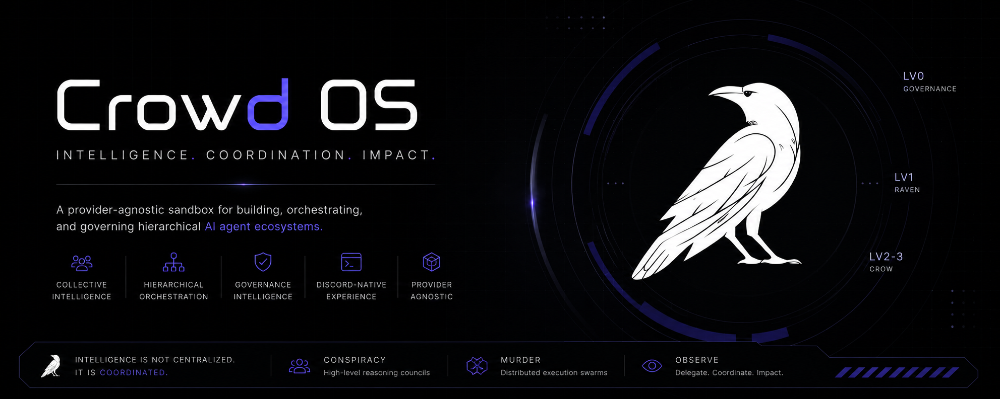

# CrowdOS



> **Intelligence emerges through coordination.**

CrowdOS is a provider-agnostic sandbox orchestration layer for multi-agent systems. Rather than a single AI assistant, it is an operational runtime that coordinates, delegates, and manages collective intelligence across models, providers, and execution layers.

CrowdOS is fundamentally:

- agent-native
- orchestration-first
- emergent by design
- sandbox-first
- provider-agnostic
- modular
- workspace-oriented

---

## Why CrowdOS Exists

Most multi-agent frameworks are workflow-centric, graph-heavy, YAML-driven, CLI-oriented, developer-only environments.

CrowdOS takes a different approach: a social-native operating environment. Inspired by community platforms like Discord, structure is meant to be seen and navigated — organizing a community of specialists, not wiring up a pipeline.

Users interact through workspaces, categories, channels, mentions, permissions, and delegation chains instead of writing orchestration graphs manually.

---

## Core Concepts

### Workspace-first

The Workspace is the primary operational boundary — conceptually similar to a Discord server. Categories group Channels; Channels are session boundaries holding history, runtime selection, the active agent, and a filesystem mount. Each Workspace is isolated: same-named agents in different Workspaces are separate instances with separate memory.

```text
CrowdOS
└── Workspace
    ├── Categories
    │   └── Channels / Sessions
    │       ├── History
    │       ├── Runtime Selector
    │       ├── Active Agent
    │       └── Filesystem Mount
    ├── Agent Roster
    │   └── Agent Instances
    │       └── Private Agent Memory
    └── Workspace Configuration
```

### History belongs to the session, memory belongs to the agent

Channel History is shared session history. Agent Memory is private per agent instance — agents can remember, discard, and delete their own memories via tools. One agent can participate in multiple Channels without dragging another session's history along.

Agents switch between shared and focused context with `lock_in` / `lock_out`, without splitting the Channel. Multiple mentions (`@Raven @Crow @Owl`) route the same message to each agent for comparison — execution is serial in shared context, and a multi-mention is not a swarm.

### No VFS, local-first

CrowdOS mounts real local repositories, not a virtual filesystem. Mount inheritance is Workspace → Category → Channel Override, where an override **replaces** rather than merges. The local filesystem (`sandbox/` by default) is the source of truth — JSON for state, Markdown for Skills and Instructions. PostgreSQL/pgvector is optional memory/RAG infrastructure; the system stays operational on local persistence alone.

---

## Agent Hierarchy

Two axes, never confused: **authority level (L0–L3)** decides what an agent *may do*; **label (Raven / Crow)** is thematic identity for what an agent *is*.

- **Raven** — flagship intelligence. Expensive, deliberate, solitary. Strategy, architecture, judgment, deep analysis.
- **Crow** — generalist army. Cheaper, plentiful, crowded. Scraping, summarization, classification, parallel work.

The label boundary falls between L1 and L2: the top half reasons, the bottom half executes.

| Tier | Label | Role | Scope | Memory | Orchestrates |
|------|-------|------|-------|--------|--------------|
| L0 | Raven | Personal Assistant | Whole Workspace | Private | Yes |
| L1 | Raven | Specialist | A defined domain | Private | Via L2 |
| L2 | Crow | Sub-Specialist | A bounded task | Private | Yes (swarm) |
| L3 | Crow | Worker | One narrow subtask | Stateless | No |

**L0** is the highest Workspace authority and the user's personal assistant — privileged tools, final fallback in default-agent resolution, and the only tier that can activate the prestige features. **L1** specialists are user-configured (instructions + model/provider + tools/skills + memory). **L2** orchestrators receive a bounded task from their L1, fan out to L3 workers, and return a consolidated report. **L3** workers are stateless: no persistent identity, no private memory, one surgical subtask each.

Authority always comes from the **level**, never the name. Owl (the Librarian) is a workspace-level indexing service, not a conversational agent.

### Conspiracy and Murder (prestige, non-priority)

- **Conspiracy** — a council of 2–5 Ravens. Heavy-reasoning debate; value comes from disagreement, not throughput. Needs its own orchestration pattern when built.
- **Murder** — a swarm of Crows. Mechanically the Swarm Runtime, entered through its own L0-activated gateway.

Both trigger only via explicit L0 activation (`Start a Murder` / `Start a Conspiracy`), never by mention, `Auto` routing, or lower tiers. When built, both must be genuine coordination structures, not labels on ordinary execution.

---

## Runtimes

Five runtimes, plus `Auto` — which is not a runtime but the Interpreter → Router selection path that chooses among them.

1. **Conversational** (Chat) — chat, brainstorming. Low cost, short memory, fast, minimal tools.
2. **Agentic** — ReAct-style execution with tools, sandbox-aware, dynamic capability discovery.
3. **Coding** — repository work on a deliberately forked, battle-tested coding engine (`@crowdspace/pi-core`), full filesystem tool surface, diff-oriented output.
4. **Research** — investigation with evidence bundles and cited synthesis.
5. **Swarm** — large workloads decomposed into narrow subtasks, delegated to L3 workers with bounded concurrency, then aggregated and verified.

Every runtime honors the same `RuntimeResult` contract (checked by a conformance suite), the same tool authorization rules, cancellation semantics, and usage accounting. Shipped defaults route Research and Swarm back to Agentic (`RESEARCH_V1` / `SWARM_V1` default `false`); the rollback is reported, not hidden.

---

## Providers

Provider-agnostic by design. Five adapters ship in `packages/server/src/runtime/providers/`: `google`, `openai`, `anthropic`, `ollama`, `custom` — with tiered model routing and real usage accounting so budgets see true cost.

---

## Nitehunter

Nitehunter is CrowdOS's complementary precision-review subsystem (Hunt / Perch / Strike / Pellet / Roost / Silent Flight / Parliament) — system-first observational intelligence beside CrowdOS's agent-first orchestration. It shares the authority hierarchy but is not a sixth runtime. **No implementation exists in the current codebase.**

---

## Current Status

Source of truth: `CrowdOS.md` §34. Summary:

**Implemented:** Workspace model + Portal flow, runtime selector with `Auto` routing and pin/sticky behavior, mention routing (single, pinned, multiple with serial execution + failure handling), `lock_in`/`lock_out`, agent self-managed memory, Librarian/Owl concept, local-first persistence + mount model, five-runtime set with Coding on the forked engine, contract conformance suite, serial multi-mention, stateless L3 workers with visible token accounting and bounded fan-out, structured routing logs.

**Evolving:** L0 authority model, L1/L2/L3 as enforced roles (Router-enforced today, broader rights pending), global Skills triggering, agent configuration details, memory/RAG infrastructure, `Auto` intent vocabulary, swarm data sharding by range/batch, per-subtask worker context slicing.

**Planned / pending:** event-by-event Channel History persistence (priority), large-data sharding (priority), MCP/connector mounts, variables, artifact retention/browsing UI, media support, full L0 (non-priority), workspace import/export (later), Nitehunter (no implementation).

---

## Stack

From the codebase (`package.json`, `docker-compose.yml`):

- **Client** — React 19 + Vite + TailwindCSS v4 + Zustand + `socket.io-client` (`packages/client`, dev port `3000`)
- **Server** — Node.js + Fastify 5 + TypeScript + Drizzle ORM + Socket.io + BullMQ 6 (`packages/server`, default port `3001`)
- **Coding engine** — `@crowdspace/pi-core` (in-repo fork backing the Coding Runtime)
- **Shared contracts** — `@crowdspace/shared`
- **Desktop** — Electron shell, Windows-first (`packages/desktop`)
- **Infra** — PostgreSQL 16 (primary) + Redis 7 (opt-in). Default queue mode is `inline` — `docker compose up` runs `api` + `postgres`. BullMQ delivery needs the queue profile: `docker compose --profile queue up` (adds `redis` + `worker`).

---

## Local Setup

```bash
npm install
npm run db:bootstrap   # push schema + seed (needs Postgres)
npm run dev            # api + worker + client
```

Defaults: API `http://localhost:3001`, client `http://localhost:3000` (both configurable via `PORT` / `CLIENT_ORIGIN`). Copy `.env.example` for the full option set — `QUEUE_MODE=inline` needs no Redis; set `QUEUE_MODE=bullmq` + `REDIS_URL` for durable queue delivery.

---

## Vision

CrowdOS aims to become a cognitive workspace operating layer, a distributed orchestration kernel, an adaptive runtime platform — provider-agnostic cognitive infrastructure. Not a chatbot framework, not an assistant wrapper, not a static workflow system.

> **Intelligence is not centralized. Intelligence is coordinated.**
